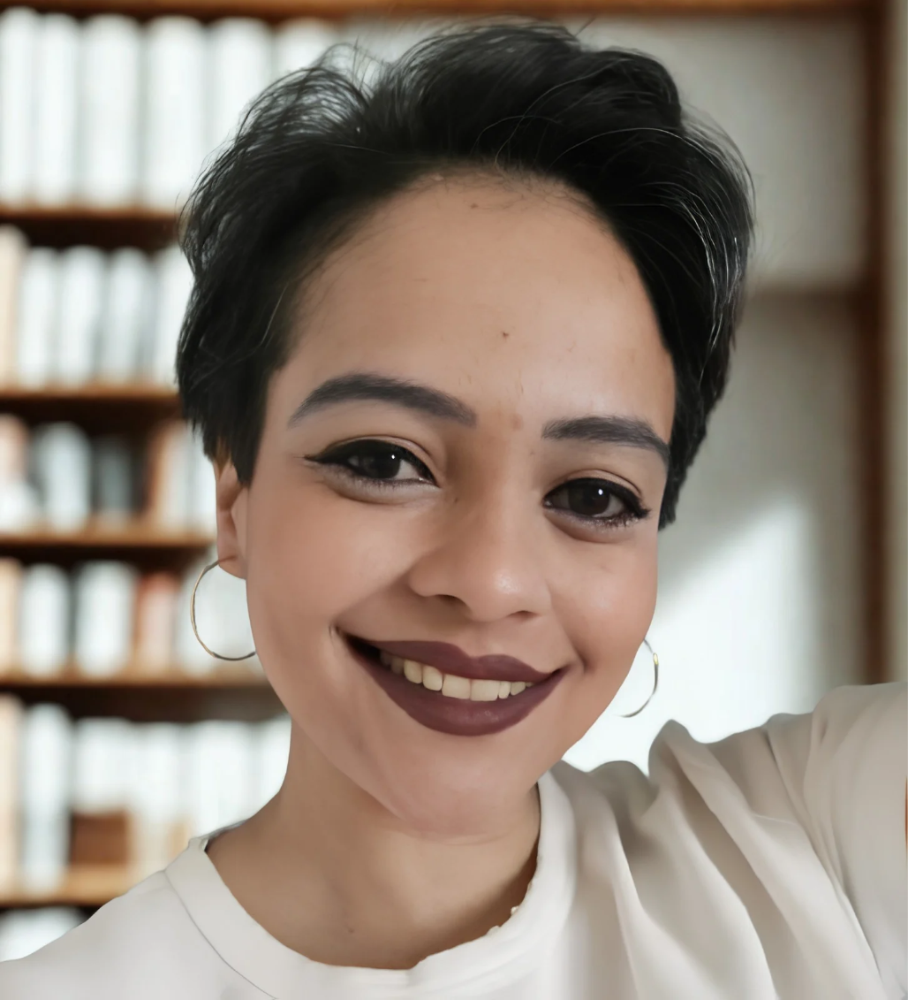

::::: about-hero
::: about-photo
{fig-alt="Retrato profissional da idealizadora da RadHub"}
:::

::: about-intro
# Oi! Que bom ter você por aqui.

Me chamo Dalila Mendonça, sou física médica, com atuação em Radioterapia, Supervisão de Proteção Radiológica e desenvolvimento de soluções para a área da saúde.

Ao longo da minha trajetória, fui construindo uma relação entre ciência, tecnologia e educação. Acredito que o conhecimento precisa ser acessível, bem explicado e, principalmente, útil para quem deseja aprender, crescer profissionalmente e transformar a própria realidade.

Foi dessa combinação de experiências e interesses que nasceu a **RadHub**.
:::
:::::

## Minha formação e trajetória

Minha jornada começou na graduação em **Física Médica pela Universidade Federal de Uberlândia (UFU)**. Durante a formação, tive a oportunidade de desenvolver pesquisa em dosimetria de feixes de raios X utilizados em radiodiagnóstico, com aplicação de simulações pelo método de Monte Carlo.

Essa experiência contribuiu para aprofundar meu interesse pela Física aplicada à saúde e pela importância de compreender os fundamentos físicos por trás das tecnologias utilizadas na prática clínica.

Posteriormente, realizei aprimoramento em **Radioterapia no Instituto Mineiro de Radio-Oncologia, em Belo Horizonte**, dando início a uma trajetória profissional dedicada à Física Médica, à segurança dos tratamentos e à qualidade dos processos assistenciais.

Ao longo dos anos, tive experiências em diferentes serviços de saúde, ampliando minha visão sobre os desafios técnicos, operacionais e humanos envolvidos no cuidado ao paciente.

## Minhas áreas de atuação

:::::::: about-areas
::: about-area
### Física da Radioterapia

Atuação relacionada aos processos físicos envolvidos no tratamento radioterápico, à qualidade dos procedimentos e à segurança na utilização das tecnologias de tratamento.
:::

::: about-area
### Proteção Radiológica

Experiência em supervisão de proteção radiológica, com foco no cumprimento dos requisitos aplicáveis, na segurança ocupacional e no uso seguro das radiações ionizantes.
:::

::: about-area
### Física Médica e qualidade assistencial

Participação na supervisão de equipes e em processos de trabalho que exigem organização, rastreabilidade, padronização e atenção aos detalhes.
:::

::: about-area
### Educação em Física Médica

Produção de materiais didáticos, preparação para provas de residência e certificações profissionais, organização de conteúdos e desenvolvimento de estratégias para tornar o aprendizado mais eficiente.
:::

::: about-area
### Tecnologia e desenvolvimento de software

Interesse em programação, engenharia de software e desenvolvimento de ferramentas que possam simplificar rotinas, organizar informações e ampliar o acesso a soluções úteis na saúde e na educação.
:::
::::::::

## Ciência, tecnologia e educação

Minha experiência profissional me mostrou que o conhecimento técnico é indispensável, mas a maneira como ele é organizado, explicado e aplicado também faz muita diferença.

Por isso, além da atuação em Física Médica, venho desenvolvendo meus conhecimentos em programação e engenharia de software. Quero explorar como a tecnologia pode ajudar a resolver problemas reais, tornar processos mais eficientes e criar ferramentas que facilitem o trabalho dos profissionais da saúde.

Esse interesse também influencia a forma como penso meus materiais educacionais: busco combinar rigor técnico, explicações didáticas, exercícios, revisões e diferentes estratégias de aprendizagem.

## Como nasceu a RadHub

A **RadHub nasceu da vontade de levar o conhecimento a mais pessoas**.

Durante minha trajetória, percebi que estudantes de Física Médica precisam conciliar muitas demandas: disciplinas da graduação, preparação para provas de residência, estágios e construção de uma base teórica sólida. Para quem já está no mercado de trabalho, ainda existem os desafios de atualização profissional e preparação para certificações.

Estudar tudo isso exige tempo, organização e materiais que realmente ajudem a compreender o conteúdo.

Foi pensando nessa realidade que comecei a desenvolver a RadHub: um projeto educacional voltado a estudantes e profissionais de Física Médica, com materiais que buscam unir qualidade técnica, clareza e diferentes metodologias de aprendizagem.

A proposta é oferecer recursos que façam sentido para a rotina de quem estuda, como:

- **Videoaulas:** para aprofundar os conceitos e compreender os assuntos com mais clareza.
- **E-books:** para organizar o conteúdo e facilitar as revisões.
- **Exercícios e simulados:** para praticar, identificar dificuldades e desenvolver familiaridade com questões de prova.
- **Flashcards:** para apoiar a revisão e a memorização ao longo do tempo.
- **Acompanhamento e orientação:** para ajudar o estudante a organizar os estudos e direcionar seus esforços.

Cada material é pensado com um objetivo: ajudar você a aproveitar melhor seu tempo de estudo e construir um aprendizado consistente.

## Mais do que cursos, um projeto em construção

Criar a RadHub também é uma oportunidade de unir diferentes partes de quem sou: a física médica, a experiência clínica, o interesse pela educação e a vontade de desenvolver soluções por meio da tecnologia.

Por trás de cada aula, e-book, exercício e ferramenta, existe um processo de estudo, planejamento, criação e melhoria contínua.

A RadHub está em constante desenvolvimento, assim como eu. Quero continuar aprendendo, aprimorando os materiais e ouvindo quem utiliza nossos recursos, porque acredito que uma boa experiência educacional é construída com conhecimento, dedicação e abertura para melhorar.

::: about-quote
**Meu propósito é ajudar você a aprender mais, com clareza, qualidade e propósito — mesmo quando o tempo para estudar é limitado.**
:::

Seja bem-vindo(a) à RadHub! 💙

Espero que este espaço contribua para a sua formação e acompanhe você em cada etapa da sua trajetória.
